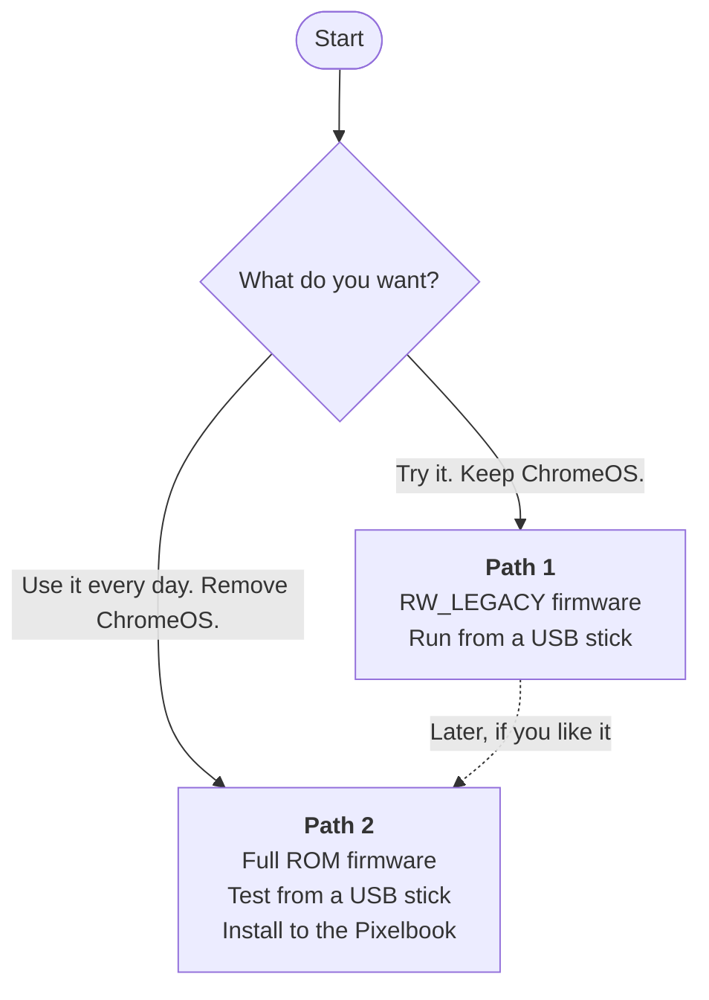

<h1 align="center">Googlebook OS on the 2017 Google Pixelbook</h1>

  Run Google's new <b>Googlebook OS</b> (Android 17 for laptops) on the original <b>Pixelbook</b>. 
  Scripts and patches that build it, install it, and fix what breaks on old hardware.

  
  
  
  

> [!WARNING]
> This is a hobby project. It is **not** from Google. You change your Pixelbook's firmware and you may erase ChromeOS.
> A mistake can stop the Pixelbook from starting. Read each guide fully before you start.

## What is this?

Google makes Googlebook OS for new laptops. The 2017 Pixelbook is too old for it. Its processor lacks instructions
that Googlebook OS needs, and Google's kernel has no driver for its graphics chip.

This project fixes that. The main parts:

- A **kernel patch** that runs the missing processor instructions in software.
- The **graphics driver** for the Pixelbook's Intel chip.
- A **fix for a bug** in Google's audio driver that froze the Pixelbook.
- An **installer** that copies Googlebook OS to the Pixelbook's own storage.

It builds on [gbrunch](https://github.com/danbyumagic/gbrunch), which runs Googlebook OS on an HP laptop.

> [!IMPORTANT]
> **There is no ready-made download.** The system contains Google's software, and we cannot share it.
> You build the image on your own PC with one command. The build downloads Google's official files for you.

## What works

| Works on the Pixelbook | Does not work yet |
|---|---|
| ✅ Start, Google setup and sign-in, Play Store | ❌ **Continue On** and phone-assisted setup (needs a Google security key that this device does not have) |
| ✅ Graphics, touchscreen, touchpad, keyboard | ❌ **Suspend** (the lid keeps the Pixelbook awake) |
| ✅ Wi-Fi and Bluetooth | ❌ Over-the-air updates (you rebuild instead) |
| ✅ Brightness, webcam, speakers | ❌ Keyboard backlight |
| ✅ Quick Share | ❓ Headphone jack, microphones, HDMI audio (not tested yet) |

It is slower than ChromeOS. Details: [docs/STATUS.md](docs/STATUS.md).

> [!NOTE]
> The table shows what works on one Pixelbook with Google's June 2026 build (16452207). Google released a newer build
> (16658739), and its setup needs it. This repository builds the newer one. It starts correctly in a virtual machine.
> A test on a Pixelbook is still to do.

## Pick your path

| | **Path 1: Try it** | **Path 2: Daily use** (recommended) | Path 2b: Install with RW_LEGACY |
|---|---|---|---|
| Firmware | RW_LEGACY | **Full ROM** | RW_LEGACY |
| Write protection | Stays on | You turn it off once | Stays on |
| ChromeOS | Stays | Removed | Removed |
| Each start | Press **Ctrl+L** at a warning screen | Starts alone | Press **Ctrl+L** at a warning screen |
| Apps and files | Lost at each restart | Kept | Kept |
| Speed | Slow (USB stick) | Faster | Faster |

Not sure? Choose **Path 1**. You can move to Path 2 later.

## What you need

- A **2017 Google Pixelbook** (board name `EVE`) and its charger.
- A **PC** with Windows 10/11 or Linux. About **130 GB** of free disk space and **2 hours** for the build.
- A **USB stick** with 32 GB or more (erased during the process).
- A second, small **USB stick** for your firmware backup (Path 2 only).
- A Google account for the Googlebook setup.

## Step by step

| Step | What you do | Guide |
|---|---|---|
| **1** | Install new firmware on the Pixelbook. Do this **before** you remove ChromeOS. | [docs/FIRMWARE.md](docs/FIRMWARE.md) |
| **2** | Build the image on your PC. One command: `./build.sh` | [docs/BUILD.md](docs/BUILD.md) |
| **3** | Write the image to a USB stick with Rufus. Start the Pixelbook from it. | [docs/INSTALL.md](docs/INSTALL.md) |
| **4** | Optional: install to the Pixelbook. This erases ChromeOS. | [docs/INSTALL.md](docs/INSTALL.md#b-install-to-the-pixelbook-erases-chromeos) |
| **5** | Check that everything works. | [docs/TESTING.md](docs/TESTING.md) |

Questions? Read the [FAQ](docs/FAQ.md).

## Learn more

- **[How it works](docs/how-it-works.html)** — an interactive guide. Download it and open it in a browser.
- **[Engineering notes](docs/engineering-notes.md)** — every finding and its evidence.
- **[Component reference](docs/components.md)** — what each script does.

Repository layout

| Path | Contents |
|---|---|
| `build.sh` | Builds everything. |
| `scripts/` | Downloads and checks Google's files, with pinned versions (`pins.sh`). |
| `kernel/` | Kernel changes, the instruction emulator and the fixed audio driver. |
| `isa_emu/` | The instruction emulator core and its tests. |
| `image/` | Builds the final disk image. |
| `install/` | The installer that copies the system to the Pixelbook. |
| `audio/`, `input/`, `policy/` | Audio setup, keyboard and touchpad files, security rules. |
| `qemu/` | Virtual machine tests. |
| `windows/` | PowerShell tools for USB sticks and logs. |
| `tools/` | Analysis tools from development. |

## Credits and licences

- Built on [gbrunch](https://github.com/danbyumagic/gbrunch) (MIT). Read [CREDITS.md](CREDITS.md) for everyone else.
- Scripts and settings: MIT ([LICENSE](LICENSE)).
- Kernel code and the instruction emulator (`kernel/`, `isa_emu/`): GPL-2.0 ([LICENSES/GPL-2.0.txt](LICENSES/GPL-2.0.txt)).
- Googlebook OS belongs to Google. This project does not include it.

This project is not affiliated with or endorsed by Google, Lenovo or Intel. You use it at your own risk.
